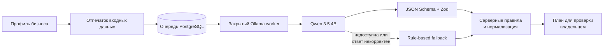
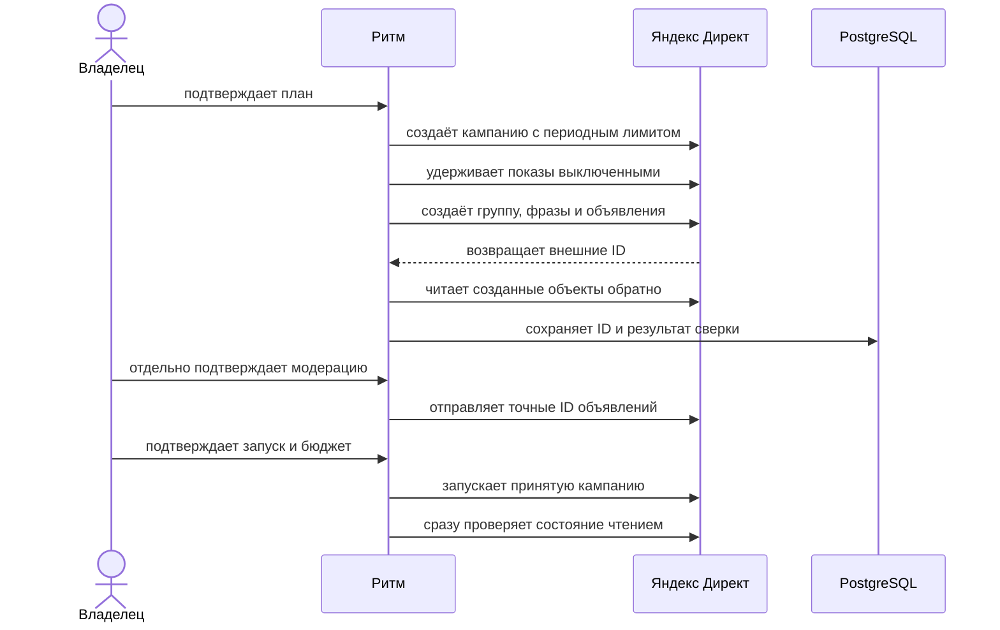
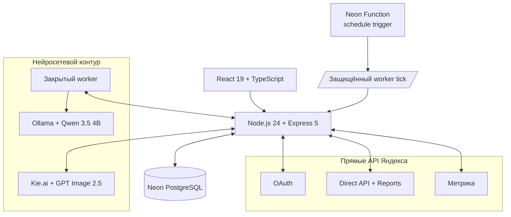

<p align="center">
  
</p>

<h1 align="center">Ритм</h1>

<p align="center">
  Автопилот рекламы для малого бизнеса.<br>
  Владелец рассказывает о компании, задаёт бюджет и получает готовую рекламу без работы со ставками и рекламными кабинетами.
</p>

<p align="center">
  <a href="https://ritm-ads.onrender.com">Открыть production</a> ·
  <a href="app/docs/ACCEPTANCE.md">Сценарий приёмки</a> ·
  <a href="app/docs/RENDER_DEPLOY.md">Развёртывание</a> ·
  <a href="app/docs/STATUS.md">Текущий статус</a>
</p>


## Задача

Малому бизнесу обычно нужен результат, а не ещё один рекламный кабинет. Ритм
переводит обычное описание компании в рекламный план, помогает согласовать
тексты и изображения, создаёт выключенные кампании через прямой API Яндекс
Директа и следит за результатами после запуска.

Пользователь контролирует решения, которые могут затронуть деньги. Создание
черновика, модерация и запуск показов разделены. Неопределённый ответ внешнего
API не повторяется, пока Ритм не сверит фактическое состояние чтением.

## Путь владельца бизнеса

```mermaid
flowchart LR
    A[Войти через Google] --> B[Рассказать Рите<br/>о бизнесе]
    B --> C[Подключить<br/>Яндекс Директ]
    C --> D[Проверить план,<br/>тексты и изображения]
    D --> E[Создать выключенные<br/>кампании]
    E --> F[Отправить объявления<br/>на модерацию]
    F --> G[Подтвердить запуск<br/>и лимит]
    G --> H[Получать отчёты<br/>и обращения]
    H --> I[Автопилот и A/B]
    I --> J[История причин<br/>и откат]
```



В интерфейсе нет ставок, типов стратегий и служебных идентификаторов в основном
маршруте. Вместо них Ритм показывает цель, аудиторию, общий лимит, ожидаемый
следующий шаг и причину каждого решения.

## Рита знакомится с бизнесом


Рита собирает профиль в разговоре. Она спрашивает только о том, чего ещё не
хватает: названии, сфере, городе, продвигаемой услуге, преимуществе и месячном
бюджете. Сайт можно добавить позже. Ответы видны рядом с диалогом и доступны для
исправления до подготовки рекламы.

Рита умеет:

- принять короткий ответ на текущий вопрос и не заставлять пользователя
  повторять уже рассказанное;
- понять естественную поправку вроде «измени бюджет на 40 000 ₽»;
- сохранить подтверждённые факты при исправлении одного поля;
- показать прогресс через «дерево рекламы»;
- собрать первый план даже при временно недоступной языковой модели.

Рита не получает OAuth-токены и не вызывает Direct. Её зона ответственности
заканчивается на структурированном профиле и рекламном плане.

## Нейросетевой модуль

Текстовый модуль работает на Qwen 3.5 4B через Ollama. В hosted-режиме Render
сохраняет задание в PostgreSQL, а закрытый worker забирает его по HTTPS. В
задании есть описание бизнеса, бюджет и период. Токены Яндекса и команды записи
worker не получает.



Модель предлагает:

- краткую стратегию и аудитории;
- поиск и Рекламную сеть, если бюджет допускает два направления;
- ключевые и минус-фразы;
- три содержательно разных текста;
- распределение общего бюджета;
- гипотезы A/B-теста, метрику и условия сравнения.

Ответ модели не принимается как команда. Сервер проверяет длину текстов,
уникальность фраз, сумму распределения бюджета и запрещает неподтверждённые
цены, скидки, гарантии, лицензии и рейтинги. Некорректный JSON отбрасывается.
При сбое используется ограниченный план по правилам, внешних записей при этом
нет.

## План остаётся понятным


План отвечает на четыре вопроса: кому показываем, где начинаем, какую гипотезу
проверяем и сколько можно потратить. Общий лимит делится между направлениями,
но автопилот не может сам увеличить сумму владельца.

До создания рекламы можно изменить профиль, выбрать один или несколько текстов
и согласовать материалы. Каждый текст остаётся редактируемым. Изменённый вариант
нужно подтвердить повторно.

## Генерация изображений


Рита превращает профиль бизнеса в предметный бриф для Kie.ai. Prompt фиксирует
услугу, покупателя, город, рекламную цель, сцену и композицию. Для магазина
компьютеров он требует показать работающую технику и консультацию, а не коробку
без контекста. Для сцен с руками действуют отдельные ограничения против
искажённой анатомии и парящих предметов.

После генерации сервер:

1. кадрирует изображение под 4:3, 1:1, 16:9 или 3:4;
2. собирает непрозрачный JPEG до 4 МБ;
3. наносит название бизнеса точным текстом через Sharp, если пользователь
   выбрал плашку;
4. сохраняет модель, размеры и SHA-256;
5. ждёт ручного согласования;
6. отдельным действием загружает файл в библиотеку Direct и сверяет
   `AdImageHash`.

Kie.ai не рисует название компании. Это убирает случайные буквы и ошибки в
кириллице. Генерация не публикует материал и не запускает показы.

## Прямой контур Яндекс Директа

Ритм работает без Click.ru, eLama и других посредников. OAuth и операции с
кампаниями идут через прямой API Яндекса.



Поиск и Рекламная сеть получают независимые периодные лимиты. Если Директ
нормализовал фразу или сохранил только часть безопасных фраз, Ритм продолжает с
подтверждённым набором и показывает предупреждение об уменьшенном охвате.
Чужая кампания, изменённый лимит или неожиданно включённые показы по-прежнему
блокируют продолжение.

## Отчёты и автопилот


Фоновый worker получает отчёты Direct и Метрики, сохраняет каждый источник
отдельно и связывает строки с точной кампанией. Пустой отчёт не считается
нулевой эффективностью, а устаревшие или неполные данные не разрешают запись.

После накопления сопоставимых данных автопилот может:

- остановить направление с высокой стоимостью обращения;
- перенести только подтверждённый свободный остаток в лучшее направление;
- сохранить общий лимит бизнеса без автоматического увеличения;
- подготовить вариант Б для пограничной эффективности;
- дождаться минимальной выборки и применить решение;
- записать причину и создать компенсирующий откат.

Каждое действие проходит read-back. Потерянный ответ API не повторяется
автоматически: сначала worker выясняет, было ли изменение принято площадкой.

## Архитектура



| Слой           | Реализация                                                             |
| -------------- | ---------------------------------------------------------------------- |
| Интерфейс      | React 19, TypeScript, Vite, адаптивная тёмная тема                     |
| API            | Node.js 24, Express 5, Zod                                             |
| Данные         | Neon PostgreSQL; SQLite для изолированного демо                        |
| Авторизация    | Google OAuth; подключение Яндекса через OAuth                          |
| Планировщик    | Qwen 3.5 4B через Ollama, серверный fallback                           |
| Изображения    | Kie.ai GPT Image 2.5, Sharp, локальный OpenVINO как вариант разработки |
| Реклама        | прямой Яндекс Директ API, отдельные write-gates                        |
| Аналитика      | Direct Reports и Яндекс Метрика                                        |
| Фоновые задачи | PostgreSQL queues и Neon Function schedule trigger                     |

## Защита бюджета и внешних записей

- В development и demo платные записи выключены.
- Production требует HTTPS, PostgreSQL, постоянный ключ шифрования и явные
  флаги для каждого класса операций.
- Токены хранятся зашифрованно с привязкой к бизнесу.
- Кампания создаётся выключенной; модерация не запускает показы.
- Периодный лимит в Direct совпадает с утверждённым планом, автопродление
  запрещено.
- Budget Guard использует только свежий отчёт с точной атрибуцией.
- Откат записывается новым событием. История не переписывается.

## Покрытие требований задания

| Требование                           | Что есть в проекте                                                                      |
| ------------------------------------ | --------------------------------------------------------------------------------------- |
| Самостоятельное подключение кабинета | Google-вход, OAuth Яндекса, выбор доступного Direct-логина                              |
| Создание кампаний                    | Поиск и Рекламная сеть через прямой API, выключенный черновик, read-back                |
| Широкий охват                        | Несколько текстов и изображений, ключевые фразы, два направления при допустимом бюджете |
| Контроль расходов                    | Общий владелецкий лимит, периодные лимиты направлений, Budget Guard                     |
| Остановка и перераспределение        | PostgreSQL optimizer, безопасная остановка, перенос остатка, компенсирующий откат       |
| A/B                                  | Неизменяемая гипотеза, вариант Б, отдельный отчёт, решение после минимальной выборки    |
| Статистика                           | Расход, показы, клики, обращения и стоимость обращения из первоисточников               |
| История                              | Человеческая причина, технические детали и связь с откатом                              |
| Изображения                          | Kie.ai, ручное согласование, подготовка форматов, загрузка в Direct                     |
| Новые OAuth-приложения               | Все client ID и secrets задаются окружением, код менять не нужно                        |

Реальные показы, расходы, обращения и решения optimizer доказываются отчётами
конкретного live-пилота. Автоматические тесты проверяют контракты и безопасность,
но не подменяют доказательство трафика. Актуальные границы перечислены в
[статусе проекта](app/docs/STATUS.md).

## Локальный запуск

Нужны Node.js 24 и npm.

```powershell
cd app
Copy-Item .env.example .env
npm ci
npm run check
npm start
```

Откройте `http://localhost:4310`. Демо хранит данные в `app/data/ritm.sqlite`
и не отправляет изменения в рекламные API.

Основные проверки:

```powershell
npm test
npm run build
npm run test:e2e
python -m unittest discover -s ai -p "test_*.py" -v
```

## Production-развёртывание

Production использует Render для веб-приложения и Neon PostgreSQL для данных и
очередей. OAuth-приложения, ключ шифрования, gates внешних записей и AI worker
задаются переменными окружения.

```powershell
cd app
npm ci
npm run db:migrate:postgres
npm run db:verify:postgres
npm run production:preflight:strict
npm start
```

Полная последовательность настроек находится в
[инструкции Render и Neon](app/docs/RENDER_DEPLOY.md). Для live-пилота используйте
[операционный runbook](app/docs/PRODUCTION_RUNBOOK.md).

## Навигация по коду

| Путь                                       | Назначение                                              |
| ------------------------------------------ | ------------------------------------------------------- |
| `app/src/`                                 | интерфейс и пользовательские маршруты                   |
| `app/server/app-postgres.js`               | hosted API, auth и owner-scoped endpoints               |
| `app/server/ai-plan.js`                    | схема и проверка рекламного плана                       |
| `app/server/postgres-direct.js`            | preflight и создание выключенных кампаний               |
| `app/server/postgres-direct-moderation.js` | проверка рекламодателя и модерация                      |
| `app/server/postgres-direct-resume.js`     | подтверждённый запуск и read-back                       |
| `app/server/postgres-autopilot.js`         | отчёты, Budget Guard, optimizer и откат                 |
| `app/server/postgres-ab.js`                | A/B-планы, наблюдения и решения                         |
| `app/server/postgres-creatives.js`         | очередь изображений и согласование                      |
| `app/server/providers.js`                  | клиенты Яндекс API                                      |
| `app/neon/functions/autopilot-cron/`       | внешний schedule trigger                                |
| `app/tests/`                               | unit, contract и API-тесты без платных внешних действий |

## Границы

Ритм не пополняет рекламный кабинет и не возвращает уже потраченные средства.
Видео пока не генерируется автоматически. Архивация необратима и выключена по
умолчанию. Первый реальный запуск требует данных рекламодателя, опубликованной
страницы, принятого объявления, средств в кабинете и явного подтверждения
владельца.
