<p align="center">
  
</p>

<h1 align="center">Ритм</h1>

<p align="center">
  Автопилот рекламы для малого бизнеса.<br>
  Владелец рассказывает о компании, задаёт бюджет и получает готовую рекламу без работы со ставками и рекламными кабинетами.
</p>

<p align="center">
  <a href="https://ritm-ads.onrender.com">Открыть production</a> ·
  <a href="#ollama-установка-worker-на-windows">Ollama</a> ·
  <a href="#kieai-генерация-изображений">Kie.ai</a> ·
  <a href="app/docs/ACCEPTANCE.md">Сценарий приёмки</a> ·
  <a href="app/docs/RENDER_DEPLOY.md">Развёртывание</a> ·
  <a href="app/docs/STATUS.md">Текущий статус</a>
</p>

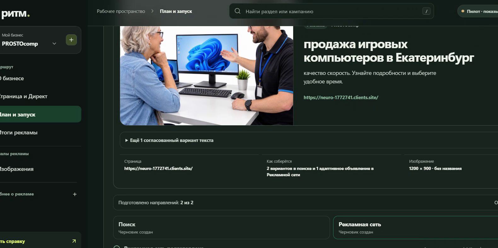

## Задача

Малому бизнесу обычно нужен результат, а не ещё один рекламный кабинет. Ритм
переводит обычное описание компании в рекламный план, помогает согласовать
тексты и изображения, создаёт выключенные кампании через прямой API Яндекс
Директа и следит за результатами после запуска.

Пользователь контролирует решения, которые могут затронуть деньги. Создание
черновика, модерация и запуск показов разделены. Неопределённый ответ внешнего
API не повторяется, пока Ритм не сверит фактическое состояние чтением.

## Путь владельца бизнеса

```mermaid
flowchart LR
    A[Войти через Google] --> B[Рассказать Рите<br/>о бизнесе]
    B --> C[Подключить<br/>Яндекс Директ]
    C --> D[Проверить план,<br/>тексты и изображения]
    D --> E[Создать выключенные<br/>кампании]
    E --> F[Отправить объявления<br/>на модерацию]
    F --> G[Подтвердить запуск<br/>и лимит]
    G --> H[Получать отчёты<br/>и обращения]
    H --> I[Автопилот и A/B]
    I --> J[История причин<br/>и откат]
```

В интерфейсе нет ставок, типов стратегий и служебных идентификаторов в основном
маршруте. Вместо них Ритм показывает цель, аудиторию, общий лимит, ожидаемый
следующий шаг и причину каждого решения.

## Рита знакомится с бизнесом

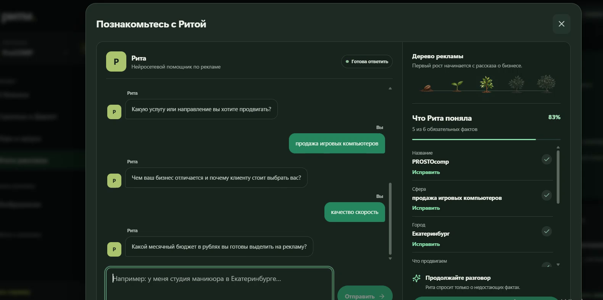

Рита собирает профиль в разговоре. Она спрашивает только о том, чего ещё не
хватает: названии, сфере, городе, продвигаемой услуге, преимуществе и месячном
бюджете. Сайт можно добавить позже. Ответы видны рядом с диалогом и доступны для
исправления до подготовки рекламы.

Рита умеет:

- принять короткий ответ на текущий вопрос и не заставлять пользователя
  повторять уже рассказанное;
- понять естественную поправку вроде «измени бюджет на 40 000 ₽»;
- сохранить подтверждённые факты при исправлении одного поля;
- показать прогресс через «дерево рекламы»;
- собрать первый план даже при временно недоступной языковой модели.

Рита не получает OAuth-токены и не вызывает Direct. Её зона ответственности
заканчивается на структурированном профиле и рекламном плане.

## Нейросетевой модуль

Текстовый модуль работает на Qwen 3.5 4B через Ollama. В hosted-режиме Render
сохраняет задание в PostgreSQL, а закрытый worker забирает его по HTTPS. В
задании есть описание бизнеса, бюджет и период. Токены Яндекса и команды записи
worker не получает.

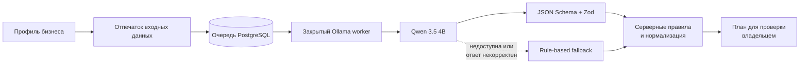

Модель предлагает:

- краткую стратегию и аудитории;
- поиск и Рекламную сеть, если бюджет допускает два направления;
- ключевые и минус-фразы;
- три содержательно разных текста;
- распределение общего бюджета;
- гипотезы A/B-теста, метрику и условия сравнения.

Ответ модели не принимается как команда. Сервер проверяет длину текстов,
уникальность фраз, сумму распределения бюджета и запрещает неподтверждённые
цены, скидки, гарантии, лицензии и рейтинги. Некорректный JSON отбрасывается.
При сбое используется ограниченный план по правилам, внешних записей при этом
нет.

## Ollama: установка worker на Windows

Проверяющему не нужно менять исходный код. Нужны Windows 10 или новее, Git,
Node.js 24 и значение `REMOTE_AI_WORKER_TOKEN` из Environment сервиса Render.
Токен на ноутбуке и в Render должен совпадать.

### 1. Скачать проект и зависимости

```powershell
git clone https://github.com/SeniorDanilBodrov/ritm-ads.git
Set-Location .\ritm-ads\app
node --version
npm ci
```

`node --version` должен показать версию 24 или новее.

### 2. Скачать Ollama и модель

В обычном PowerShell выполните официальную команду установки:

```powershell
irm https://ollama.com/install.ps1 | iex
ollama --version
ollama pull qwen3.5:4b
```

Если команда `ollama` не появилась в текущем окне после установки, закройте
PowerShell, откройте его снова и вернитесь в папку `ritm-ads\app`. Модель
скачивается один раз и остаётся на компьютере.

### 3. Подключить worker к Render

В Render откройте Environment сервиса и скопируйте значение
`REMOTE_AI_WORKER_TOKEN`. Затем выполните:

```powershell
powershell.exe -NoProfile -ExecutionPolicy Bypass `
  -File .\scripts\install-ollama-worker.ps1 `
  -RemoteServerUrl "https://ritm-ads.onrender.com"
```

Скрипт запросит токен скрытым вводом. После ввода он:

- создаст локальный `.env.worker` без добавления секрета в Git;
- проверит и при необходимости скачает `qwen3.5:4b`;
- зарегистрирует задачу Windows `Ritm Ollama Worker`;
- запустит worker сразу и после каждого входа пользователя в Windows.

Для собственной копии Render меняется только аргумент `-RemoteServerUrl`.
Править файлы приложения не нужно.

### 4. Проверить установку

```powershell
ollama list
Invoke-RestMethod http://127.0.0.1:11434/api/tags
Get-ScheduledTask -TaskName "Ritm Ollama Worker" |
  Select-Object TaskName, State
```

В списке моделей должна быть `qwen3.5:4b`, а состояние задачи должно стать
`Running`. После перезагрузки достаточно войти в Windows: Ollama запускается в
фоне, а задача планировщика поднимает worker. Если ноутбук выключен, Ритм
показывает проверенный базовый план и сохраняет задание для последующей обработки
локальной моделью.

Официальная страница установки: [Ollama for Windows](https://ollama.com/download/windows).

## План остаётся понятным

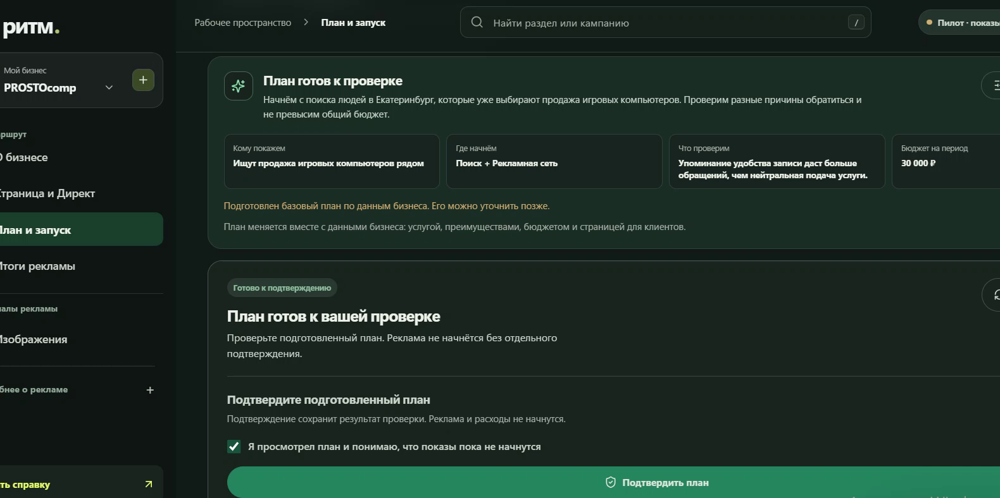

План отвечает на четыре вопроса: кому показываем, где начинаем, какую гипотезу
проверяем и сколько можно потратить. Общий лимит делится между направлениями,
но автопилот не может сам увеличить сумму владельца.

До создания рекламы можно изменить профиль, выбрать один или несколько текстов
и согласовать материалы. Каждый текст остаётся редактируемым. Изменённый вариант
нужно подтвердить повторно.

## Kie.ai: генерация изображений

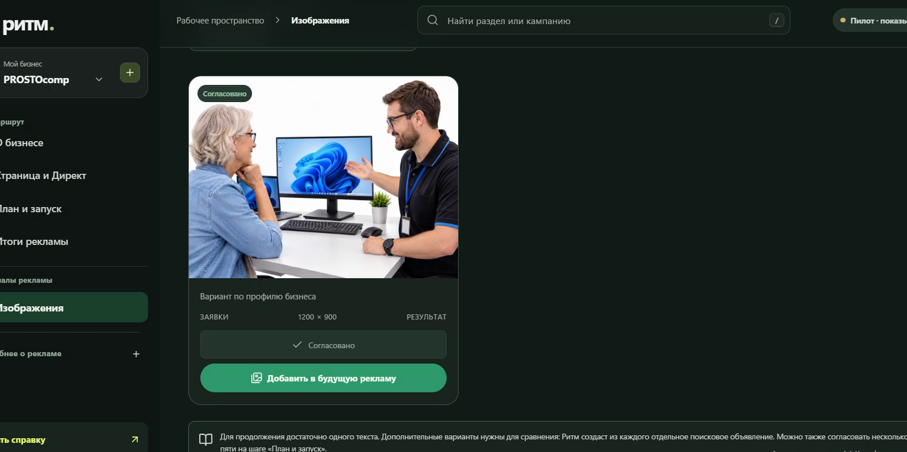

Рита превращает профиль бизнеса в предметный бриф для Kie.ai. Prompt фиксирует
услугу, покупателя, город, рекламную цель, сцену и композицию. Для магазина
компьютеров он требует показать работающую технику и консультацию, а не коробку
без контекста. Для сцен с руками действуют отдельные ограничения против
искажённой анатомии и парящих предметов.

Kie.ai используется как внешний API генерации, а не как рекламная площадка.
Владелец подключает свой API-ключ в интерфейсе и отдельно подтверждает платную
генерацию. Ключ шифруется с привязкой к business ID, не возвращается в workspace
API и не передаётся в Direct.

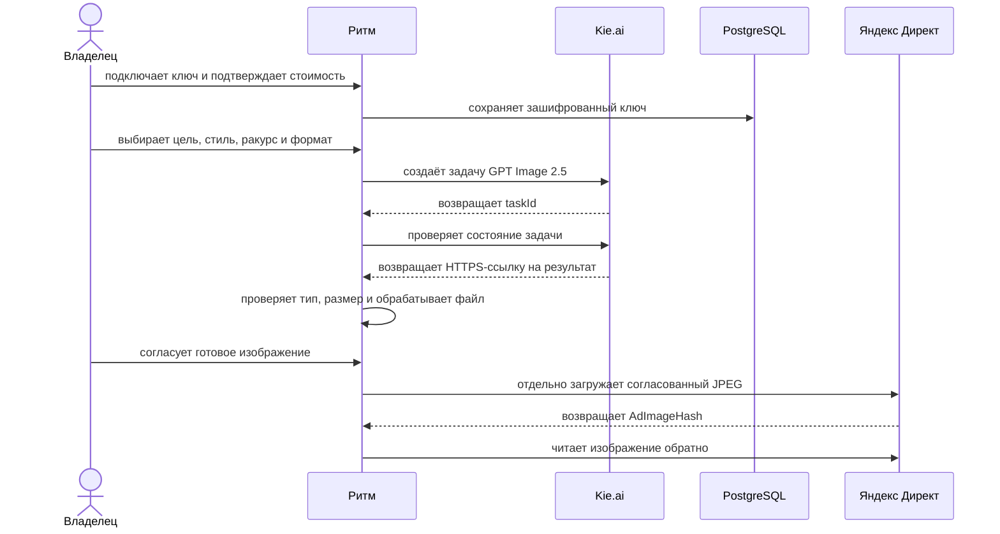

Ритм передаёт модели предметную сцену и один из поддерживаемых форматов: 4:3,
1:1, 16:9 или 3:4. Запрос создаётся асинхронно. Сервер сохраняет `taskId`,
проверяет готовность задачи, принимает только HTTPS-результат и ограничивает
размер исходного файла. Ошибка ключа, лимит запросов и незавершённая задача
показываются как разные состояния. Если Kie.ai отклонил задачу, Ритм предлагает
проверить баланс и журнал провайдера; такой ответ не считается готовым
изображением.

После генерации сервер:

1. кадрирует изображение под 4:3, 1:1, 16:9 или 3:4;
2. собирает непрозрачный JPEG до 4 МБ;
3. наносит название бизнеса точным текстом через Sharp, если пользователь
   выбрал плашку;
4. сохраняет модель, размеры и SHA-256;
5. ждёт ручного согласования;
6. отдельным действием загружает файл в библиотеку Direct и сверяет
   `AdImageHash`.

Kie.ai не рисует название компании. Это убирает случайные буквы и ошибки в
кириллице. Генерация не публикует материал и не запускает показы.

Изображение необязательно. Пользователь может выбрать «Продолжить без
изображения»: Ритм подготовит текстовые объявления в поиске и направит туда весь
лимит. Рекламная сеть в таком запуске не создаётся, потому что её формат требует
визуальный asset. Изображение можно согласовать и добавить в следующей версии
кампании.

## Прямой контур Яндекс Директа

Ритм работает без Click.ru, eLama и других посредников. OAuth и операции с
кампаниями идут через прямой API Яндекса.

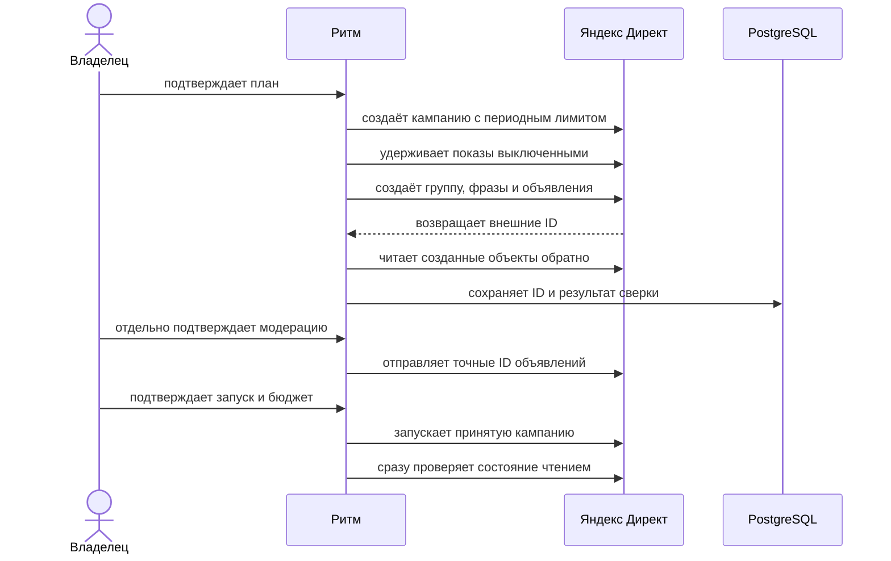

Поиск и Рекламная сеть получают независимые периодные лимиты. Если Директ
нормализовал фразу или сохранил только часть безопасных фраз, Ритм продолжает с
подтверждённым набором и показывает предупреждение об уменьшенном охвате.
Чужая кампания, изменённый лимит или неожиданно включённые показы по-прежнему
блокируют продолжение.

## Отчёты, наблюдение и автопилот

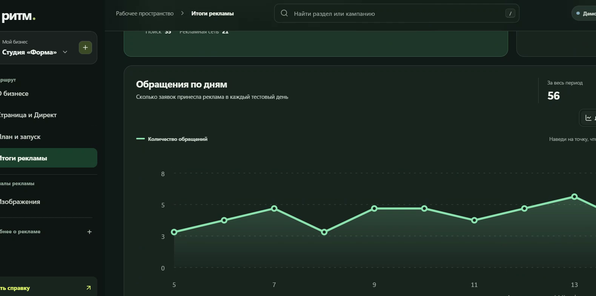

Ритм получает статистику из Direct и, если бизнес ведёт клиентов на свой сайт,
из Метрики. Снимки источников хранятся отдельно и связываются с конкретной
кампанией по внешнему ID. Поэтому пустой ответ API не превращается в «ноль
обращений», а строка одной кампании не может повлиять на другую.

### Режим наблюдения

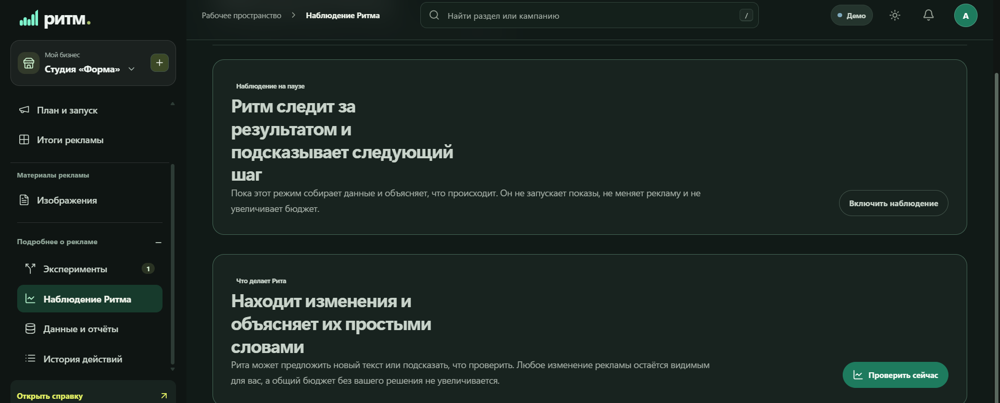

Наблюдение — безопасный read-only режим. Ритм загружает свежий отчёт, проверяет
атрибуцию и объясняет, что изменилось, но не запускает показы, не останавливает
кампании и не переносит бюджет. Этот режим нужен для первичной проверки
подключения и для демонстрации логики без расходов.

Автопилот использует тот же аналитический контур, но после всех защитных
проверок может применить решение через прямой API Direct. Он запускается
фоновым worker, а не зависит от открытой вкладки браузера.

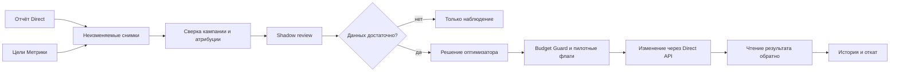

### Какие метрики читает Ритм

| Метрика               | Как считается                                           | Для чего нужна                         |
| --------------------- | ------------------------------------------------------- | -------------------------------------- |
| Показы                | Значение отчёта Direct                                  | Проверка охвата и выборки A/B-теста    |
| Клики                 | Значение отчёта Direct                                  | CTR, минимальная выборка и переходы    |
| CTR                   | `клики / показы × 100%`                                 | Сравнение текстов объявлений           |
| Обращения             | Цель Метрики либо конверсии Direct для страницы Яндекса | Фактический результат рекламы          |
| Конверсия в обращение | `обращения / клики × 100%`                              | Сравнение аудиторий и качества трафика |
| CPA                   | `расход / обращения`                                    | Сравнение результата с целью бизнеса   |
| Свободный остаток     | `лимит кампании − подтверждённый расход`                | Безопасный перенос между направлениями |

### Как автопилот принимает решение

Стандартная policy-конфигурация намеренно консервативна. Все пороги можно
изменить переменными окружения без правки кода.

| Проверка        | Стандартный порог                                                  | Результат                                   |
| --------------- | ------------------------------------------------------------------ | ------------------------------------------- |
| Зрелость данных | не менее 100 кликов и расход не менее `3 × целевой CPA`            | До порога Ритм только наблюдает             |
| Неэффективность | нет обращений либо `CPA > 1,5 × цели`                              | Готовится защитная остановка                |
| Эффективность   | `CPA < 0,8 × цели` и не менее 10 обращений                         | Можно искать менее эффективного донора      |
| Перенос         | есть вторая активная совместимая кампания и подтверждённый остаток | Остаток переносится без роста общего лимита |

Совместимость означает один кабинет и одну схему аналитики: совпадают логин,
счётчик и цель. Донор должен быть хуже получателя, но ещё не находиться в зоне
аварийной остановки. Переносить деньги из уже потраченной части лимита нельзя.

Перед записью worker повторно проверяет свежесть отчёта, статус кампании,
атрибуцию, внешний ID и отсутствие незавершённого действия. Budget Guard всегда
создаёт действие с `totalBudgetIncreaseAllowed: false`. После ответа Direct Ритм
читает кампанию обратно. Если ответ потерян, запрос не повторяется вслепую:
действие получает статус сверки, чтобы не создать повторное изменение.

В истории сохраняются исходный снимок, понятная причина, предыдущие лимиты и
результат read-back. Откат выполняется компенсирующим действием: Ритм не удаляет
историю, а возвращает подтверждённое предыдущее состояние и также сверяет его с
Direct.

### Что именно останавливает Ритм

Обычный optimizer работает на уровне рекламного направления. Если кампания
набрала зрелую выборку и вышла за порог неэффективности, worker отправляет в
Direct команду `Campaigns.suspend` для точного внешнего ID этой кампании. Другие
кампании бизнеса продолжают работать.

Отдельное проигравшее объявление останавливает A/B-контур. После завершения
теста и подтверждения победителя Ритм отправляет `Ads.suspend` для объявления,
которое проиграло. Создание варианта Б и финальное применение решения защищены
разными production-флагами. Финальное действие требует подтверждения в
интерфейсе и сверки точных ID; фоновый optimizer не выключает отдельное
объявление до этого шага.

| Сценарий                                           | Объект в Direct            | Что остаётся работать       |
| -------------------------------------------------- | -------------------------- | --------------------------- |
| Высокий CPA или нет обращений после зрелой выборки | Вся неэффективная кампания | Остальные кампании бизнеса  |
| Вариант А проиграл варианту Б                      | Отдельное объявление А     | Объявление Б и его кампания |
| Вариант Б проиграл варианту А                      | Отдельное объявление Б     | Объявление А и его кампания |

### Budget Guard

Budget Guard проверяет решение непосредственно перед записью в Direct. Между
получением отчёта и применением действия владелец или площадка могли изменить
кампанию, поэтому одного результата анализа недостаточно.

Перед остановкой Guard проверяет:

- отчёт сохранён в PostgreSQL, не устарел и относится к точной кампании;
- атрибуция обращения подтверждена Метрикой либо конверсией Direct;
- кампания принадлежит текущему подключению и имеет состояние `ON`;
- для этой кампании нет другого незавершённого optimizer-действия;
- бизнес входит в разрешённый production-контур.

После этого Ритм отправляет одну команду остановки и читает состояние обратно.
Действие считается выполненным только при состоянии `SUSPENDED`. Если соединение
оборвалось после отправки, статус меняется на `needs_reconciliation`.
Автоматический повтор запрещён: сначала Ритм выясняет фактическое состояние в
Direct, иначе одна операция могла бы выполниться дважды.

При перераспределении Guard дополнительно сверяет оба текущих лимита, период
кампаний и уже потраченную сумму. Лимит донора нельзя опустить ниже расхода, а
сумма лимитов до и после переноса обязана совпасть. Поэтому optimizer переносит
только подтверждённый остаток и не увеличивает бюджет бизнеса.

Остановку можно отменить из истории. Перед возвратом показов владелец повторно
подтверждает расходы и запуск, после чего Ритм вызывает безопасный resume и
проверяет состояние чтением. Для переноса откат восстанавливает оба предыдущих
лимита. Неоднозначный откат также блокирует повтор до сверки.

### Условия работы в production

Автоматическая остановка доступна, когда одновременно:

- `LIVE_ADS_ENABLED=true` и `AUTOPILOT_ENABLED=true`;
- `LIVE_PILOT_BUSINESS_ID` совпадает с UUID бизнеса либо равен `*`;
- приложение работает с PostgreSQL, а worker имеет свежий heartbeat;
- schedule-trigger продолжает вызывать защищённый worker tick, когда Render
  засыпает;
- кампания создана и сверена Ритмом, прошла модерацию и находится в состоянии
  `ON`;
- накоплена минимальная выборка, описанная выше.

Значение `LIVE_PILOT_BUSINESS_ID=*` нужно для приёмки под новым аккаунтом. При
фиксированном UUID автопилот продолжит читать статистику других бизнесов, но не
получит права менять их рекламу.

## A/B-тесты: что сравнивается и когда выбирается победитель

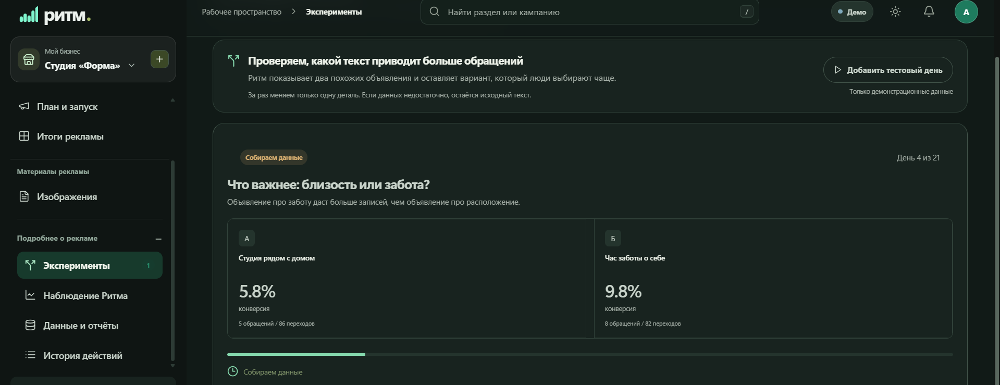

Ритм меняет в одном эксперименте только один фактор. Это позволяет связать
разницу в результате с проверяемой гипотезой, а не со случайным сочетанием
текста, аудитории и бюджета.

### Тест текстов объявлений

Варианты А и Б получают одинаковые условия показа, но разные заголовок и текст.
Основная production-метрика этого теста — **CTR**, то есть доля кликов от
показов. Для каждого варианта рассчитывается 95%-й интервал Уилсона.

Решение принимается только после окончания периода теста, если одновременно:

- тест шёл не меньше заданного срока — от 7 до 30 дней;
- каждый вариант набрал заданную выборку — не менее 500 показов;
- распределение показов осталось в пределах 40/60;
- интервалы вариантов не пересекаются.

Если верхняя граница интервала А ниже нижней границы Б, выигрывает Б. Для
обратной ситуации выигрывает А. При пересекающихся интервалах или недостаточной
выборке результат честно помечается как **неопределённый**: исходное объявление
остаётся без автоматической замены.

### Тест аудиторий

Для проверки аудитории создаются две отдельные кампании с одинаковыми текстами,
объявлениями и бюджетом. Отличается только один параметр аудитории: например,
георадиус, поисковое намерение, группа интересов или тип посетителя.

Основная метрика — **конверсия в обращение** (`обращения / клики`). Стандартные
условия финального решения:

| Условие                   | Значение по умолчанию          |
| ------------------------- | ------------------------------ |
| Длительность              | не менее 7 дней                |
| Клики                     | не менее 100 на каждый вариант |
| Обращения                 | не менее 5 на каждый вариант   |
| Баланс трафика            | от 40/60 до 60/40              |
| Вероятность превосходства | не менее 95%                   |
| Практический прирост      | не менее 15%                   |

Вероятность считается по бета-распределениям для обращений и кликов. Одной
небольшой разницы процентов недостаточно: вариант должен пройти и статистический,
и практический порог. Досрочного победителя нет.

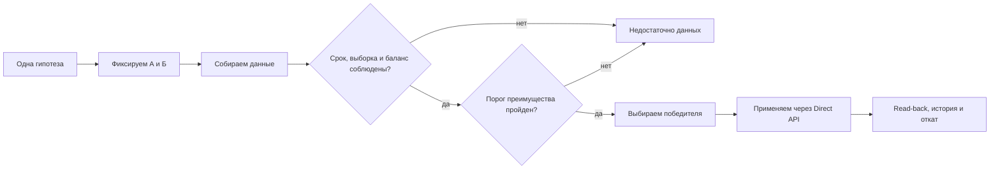

На скриншоте выше показаны демонстрационные данные интерфейса: 5 обращений из
86 переходов дают 5,8%, а 8 из 82 — 9,8%. Это иллюстрация метрики конверсии для
аудиторного теста, а не доказательство production-трафика. Реальные решения
строятся только по сохранённым снимкам Direct и Метрики.

Создание варианта Б и применение финального решения разделены двумя production-
флагами: `DIRECT_AB_VARIANT_PILOT_ENABLED` и
`DIRECT_AB_DECISION_PILOT_ENABLED`. Такое разделение позволяет сначала проверить
созданные объекты чтением, а уже затем разрешить изменение живой рекламы.

## Архитектура

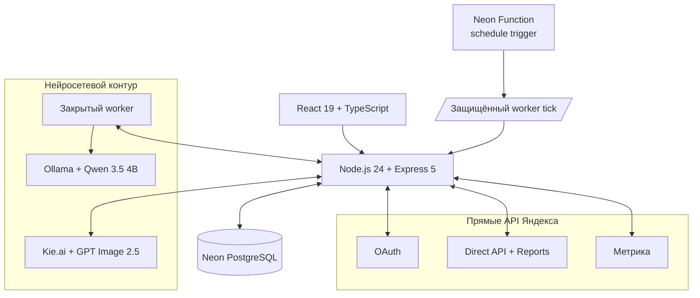

| Слой           | Реализация                                                             |
| -------------- | ---------------------------------------------------------------------- |
| Интерфейс      | React 19, TypeScript, Vite, адаптивная тёмная тема                     |
| API            | Node.js 24, Express 5, Zod                                             |
| Данные         | Neon PostgreSQL; SQLite для изолированного демо                        |
| Авторизация    | Google OAuth; подключение Яндекса через OAuth                          |
| Планировщик    | Qwen 3.5 4B через Ollama, серверный fallback                           |
| Изображения    | Kie.ai GPT Image 2.5, Sharp, локальный OpenVINO как вариант разработки |
| Реклама        | прямой Яндекс Директ API, отдельные write-gates                        |
| Аналитика      | Direct Reports и Яндекс Метрика                                        |
| Фоновые задачи | PostgreSQL queues и Neon Function schedule trigger                     |

## Защита бюджета и внешних записей

- В development и demo платные записи выключены.
- Production требует HTTPS, PostgreSQL, постоянный ключ шифрования и явные
  флаги для каждого класса операций.
- Токены хранятся зашифрованно с привязкой к бизнесу.
- Кампания создаётся выключенной; модерация не запускает показы.
- Периодный лимит в Direct совпадает с утверждённым планом, автопродление
  запрещено.
- Budget Guard использует только свежий отчёт с точной атрибуцией.
- Откат записывается новым событием. История не переписывается.

## Покрытие требований задания

| Требование                           | Что есть в проекте                                                                      |
| ------------------------------------ | --------------------------------------------------------------------------------------- |
| Самостоятельное подключение кабинета | Google-вход, OAuth Яндекса, выбор доступного Direct-логина                              |
| Создание кампаний                    | Поиск и Рекламная сеть через прямой API, выключенный черновик, read-back                |
| Широкий охват                        | Несколько текстов и изображений, ключевые фразы, два направления при допустимом бюджете |
| Контроль расходов                    | Общий владелецкий лимит, периодные лимиты направлений, Budget Guard                     |
| Остановка и перераспределение        | PostgreSQL optimizer, безопасная остановка, перенос остатка, компенсирующий откат       |
| A/B                                  | Неизменяемая гипотеза, вариант Б, отдельный отчёт, решение после минимальной выборки    |
| Статистика                           | Расход, показы, клики, обращения и стоимость обращения из первоисточников               |
| История                              | Человеческая причина, технические детали и связь с откатом                              |
| Изображения                          | Kie.ai, ручное согласование, подготовка форматов, загрузка в Direct                     |
| Новые OAuth-приложения               | Все client ID и secrets задаются окружением, код менять не нужно                        |

Реальные показы, расходы, обращения и решения optimizer доказываются отчётами
конкретного live-пилота. Автоматические тесты проверяют контракты и безопасность,
но не подменяют доказательство трафика. Актуальные границы перечислены в
[статусе проекта](app/docs/STATUS.md).

## Локальный запуск

Нужны Node.js 24 и npm.

```powershell
cd app
Copy-Item .env.example .env
npm ci
npm run check
npm start
```

Откройте `http://localhost:4310`. Демо хранит данные в `app/data/ritm.sqlite`
и не отправляет изменения в рекламные API.

Основные проверки:

```powershell
npm test
npm run build
npm run test:e2e
python -m unittest discover -s ai -p "test_*.py" -v
```

## Production-развёртывание

Production использует Render для веб-приложения и Neon PostgreSQL для данных и
очередей. OAuth-приложения, ключ шифрования, gates внешних записей и AI worker
задаются переменными окружения.

```powershell
cd app
npm ci
npm run db:migrate:postgres
npm run db:verify:postgres
npm run production:preflight:strict
npm start
```

Полная последовательность настроек находится в
[инструкции Render и Neon](app/docs/RENDER_DEPLOY.md). Для live-пилота используйте
[операционный runbook](app/docs/PRODUCTION_RUNBOOK.md).

## Навигация по коду

| Путь                                       | Назначение                                              |
| ------------------------------------------ | ------------------------------------------------------- |
| `app/src/`                                 | интерфейс и пользовательские маршруты                   |
| `app/server/app-postgres.js`               | hosted API, auth и owner-scoped endpoints               |
| `app/server/ai-plan.js`                    | схема и проверка рекламного плана                       |
| `app/server/postgres-direct.js`            | preflight и создание выключенных кампаний               |
| `app/server/postgres-direct-moderation.js` | проверка рекламодателя и модерация                      |
| `app/server/postgres-direct-resume.js`     | подтверждённый запуск и read-back                       |
| `app/server/postgres-autopilot.js`         | отчёты, Budget Guard, optimizer и откат                 |
| `app/server/postgres-ab.js`                | A/B-планы, наблюдения и решения                         |
| `app/server/postgres-creatives.js`         | очередь изображений и согласование                      |
| `app/server/providers.js`                  | клиенты Яндекс API                                      |
| `app/neon/functions/autopilot-cron/`       | внешний schedule trigger                                |
| `app/tests/`                               | unit, contract и API-тесты без платных внешних действий |
